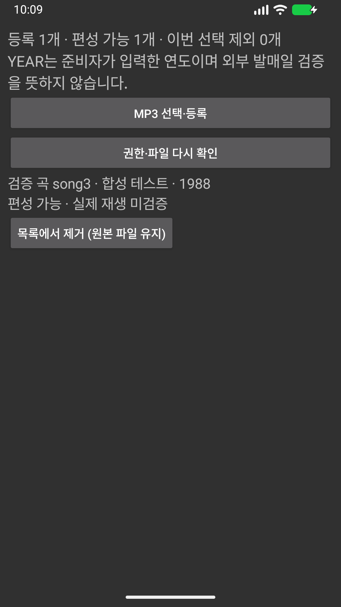
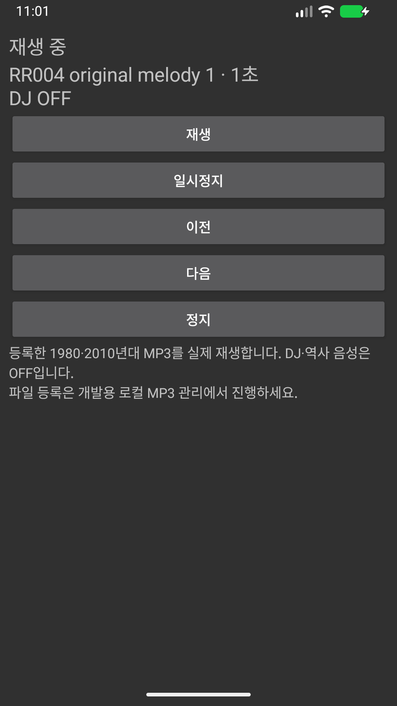
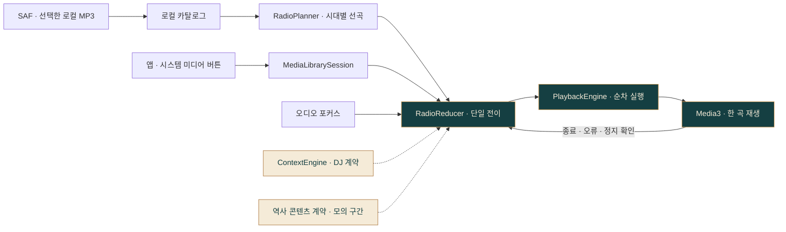

<div align="center">


# 응답하라 라디오

### 세대의 음악을 잇고, 길 위의 이야기를 만나다.

**Answer Me Radio · 현대자동차 공모전 프로젝트**

내가 가진 음악으로 시작하는, 우리 가족의 드라이브 라디오.


[프로젝트 소개](#왜-응답하라-라디오인가요) · [실제 앱 화면](#실제-앱-화면) · [검증 결과](#검증으로-확인한-것) · [실행 방법](#직접-실행하기) · [개발 로드맵](#개발-로드맵)

<sub>대표 이미지는 AI 생성 콘셉트입니다. 아래 앱 화면은 실제 에뮬레이터 캡처입니다.</sub>

</div>

---

## 왜 응답하라 라디오인가요?

같은 차에 타도 좋아하는 음악의 시대는 다릅니다. 누군가에게는 익숙한 1980년대 노래가, 누군가에게는 2010년대 노래가 여행의 배경음악이 됩니다.

**응답하라 라디오는 서로 다른 세대의 음악을 하나의 방송으로 엮는 차량용 라디오 프로젝트입니다.** 사용자가 직접 선택한 로컬 MP3에서 출발해, 시대별 선곡과 짧은 DJ 멘트로 흐름을 만들고, 선택한 경우 지나는 길의 검수된 이야기를 연결하는 경험을 목표로 합니다.

| 함께 듣는 음악 | 라디오처럼 이어지는 흐름 | 길 위의 타임머신 |
| :--- | :--- | :--- |
| 한 시대 또는 두 시대를 번갈아 편성하는 SINGLE/FAMILY 모델 | 곡 경계에서만 DJ를 배치하고, 사용자의 정지·일시정지를 우선 | 명시적으로 동의한 경우 검수된 지역 이야기와 사건 연도의 음악을 연결 |
| **선곡 로직·로컬 재생 구현** | **상황정보·DJ 계약 구현 / 실제 음성은 다음 단계** | **로컬 계약·모의 전이 구현 / 실제 콘텐츠·위치 연동 예정** |

> 현재 실제 재생 화면은 **1980·2010년대 로컬 음악 + DJ OFF**입니다. 역사 음성, 실제 위치 연동, 실차 주행 UX까지 완료한 제품으로 소개하지 않습니다.

## 실제 앱 화면

<table>
  <tr>
    <td align="center" width="50%"><strong>01 · 내 음악 등록</strong><br /><sub>SAF 선택 · 태그 확인 · 권한 관리</sub></td>
    <td align="center" width="50%"><strong>02 · 실제 로컬 음악 재생</strong><br /><sub>Media3 · 표준 제어 · 재생 위치 보존</sub></td>
  </tr>
  <tr>
    <td align="center"></td>
    <td align="center"></td>
  </tr>
  <tr>
    <td>선택한 파일만 읽습니다. 필요한 태그가 없으면 제외 사유를 표시하고, 목록 제거 시 원본 파일은 유지합니다.</td>
    <td>앱 버튼과 시스템 미디어 제어를 같은 전이 경로로 처리합니다. 실제 재생 화면과 무음 개발 시뮬레이터를 구분합니다.</td>
  </tr>
</table>

<sub>Android API37 개발판 캡처. 화면 속 곡은 검증용으로 직접 생성한 합성 음악이며, 최종 레트로 UI는 후속 단계입니다.</sub>

### 지금 체험할 수 있는 흐름

**MP3 선택 → TITLE / ARTIST / YEAR 확인 → 시대별 편성 → 실제 재생 → 표준 버튼으로 제어**

- **선택한 파일만 접근** — SAF 읽기 권한을 보존하고, 파일 삭제·권한 철회 시 다시 확인합니다.
- **시대 조건을 지키는 선곡** — 연도를 파일명이나 AI로 추측하지 않고, 필수 태그가 없는 곡은 제외합니다.
- **중단과 복귀를 분명하게** — 일시정지와 포커스 상실을 구분하고, 사용자가 멈춘 방송을 임의로 재개하지 않습니다.
- **실패해도 끝없이 반복하지 않도록** — 문제가 생긴 곡을 제외·보충하고, 연속 3회 실패하면 중단합니다.

## 한 곳에서 결정하는 재생 흐름



미디어 콜백이 직접 다음 곡을 선택하지 않습니다. **RadioReducer가 상태를 결정하고, 출력 해제를 확인한 뒤 다음 출력을 시작합니다.** 점선 경로의 DJ·역사 계약은 모의 환경에서 검증했고, 실제 재생 서비스의 음성 출력은 아직 연결하지 않았습니다.

## 검증으로 확인한 것

**2026-11-15 · RR-004 로컬 검증 스냅샷** — 아래 수치는 실행 증거에 기반하며 CI 또는 실차 인증 배지가 아닙니다.

| 검증 대상 | 결과 | 확인한 범위 |
| :--- | :---: | :--- |
| JVM 회귀 테스트 | **144 / 144** | 기존 127개 소스·테스트 유지 + 신규 17개, 실패·스킵 0 |
| Pleos API34 에뮬레이터 | **26 / 26** | 카탈로그 12개 + 실제 재생 경로 14개 |
| Android API37 에뮬레이터 | **27 / 27** | 카탈로그·실제 선택기 13개 + 재생 경로 14개 |
| Android lint | **오류 0 · 경고 0** | debug 앱·테스트 APK 생성, strict 의존성 검증 |
| 설계 원본 보존 | **27개 hash 일치** | 기존 인수 기준 54 + 40개 상태 보존 |

실제 MP3 디코더 출력 버퍼와 AudioTrack 진행, 자연 종료, 표준/legacy 제어, 오디오 포커스, 파일 삭제·권한 철회·손상 오류를 검사했습니다. 별도 UID의 허용되지 않은 브라우저 연결 거부도 확인했습니다.

**검증 경계도 함께 공개합니다.** 에뮬레이터는 호스트 무음으로 실행했으므로 물리 스피커 청취 검증은 아닙니다. 물리 USB 분리·실제 차량 버튼·주행 UX·TTS는 미검증입니다. 현재 Pleos 이미지의 파일 선택기는 stub이어서 실제 파일 선택 왕복은 일반 Android에서 검증했습니다.

[전체 검증 증거](evidence/rr004.json) · [구현과 재현 명령](docs/rr004-playback.md) · [Pleos 결과](evidence/rr004-device-ReplyRadio_RR003_API34.json) · [Android 결과](evidence/rr004-device-ReplyRadio_RR003_API37.json)

## 직접 실행하기

개발 APK에서 **`개발용 로컬 MP3 관리` → 파일 등록 → `실제 로컬 음악 재생 (DJ OFF)` → 재생** 순서로 실행합니다. TITLE·ARTIST·YEAR가 채워진 MP3와 동작하는 Android 파일 선택기가 필요합니다.

<details>
<summary><strong>개발 환경과 빌드 명령</strong></summary>

JDK17 · Android SDK35 / build-tools35 · Python3가 필요합니다. Gradle 8.10.2, AGP 8.8.2, Kotlin 2.0.0, Media3 1.6.1을 고정했습니다.

```powershell
git clone https://github.com/Branchman555/Answer-Me-Radio.git
cd Answer-Me-Radio

# 최초 1회: 테스트 APK에만 사용할 합성 MP3 생성
python -m pip install --target app/build/rr004-tools lameenc==1.8.5
python -X utf8 tools/generate_rr004_audio.py

# JAVA_HOME / ANDROID_HOME을 설정한 환경
./tools/check.ps1 -Offline
```

의존성 캐시가 없으면 `-Offline`을 생략합니다. 검증 스크립트에 `-JavaHome`, `-AndroidSdk`를 직접 전달할 수도 있습니다. 빈 캐시의 새 머신 빌드는 아직 검증하지 않았습니다.

- 앱: `app/build/outputs/apk/debug/app-debug.apk`
- 테스트 APK: `app/build/outputs/apk/androidTest/debug/app-debug-androidTest.apk`
- 장치 재현: [RR-004 문서](docs/rr004-playback.md#의존성과-재현)

본 앱 APK에는 음원을 포함하지 않습니다. 개인 MP3·키·로컬 설정·빌드 캐시는 저장소에 올리지 않습니다. 공개 배포용 release 빌드는 아직 제공하지 않습니다.

</details>

<details>
<summary><strong>코드와 문서 탐색</strong></summary>

```text
app/src/main/kotlin/radio/reply/
├── catalog/        SAF · 메타데이터 · URI 권한
├── planner/        시대별 선곡
├── orchestrator/   상태 · 이벤트 · 단일 Reducer
├── playback/       Media3 · MediaLibraryService · 표준 제어
├── context/        상황정보 · 날씨 캐시 계약
├── dj/             DJ 요청·응답 검증 · 로컬 폴백
├── story/          역사 콘텐츠 검수·권리·구간 게이트
└── demo/           명시적 무음 시뮬레이터
```

[현재 개발 기록](Archive.md) · [설계 읽기 순서](docs/design/CODEX_README_v0.8.md) · [RR-001](docs/rr001-foundation.md) · [RR-002](docs/rr002-context-dj.md) · [RR-003](docs/rr003-local-catalog.md) · [이미지 출처·제작 기록](docs/assets/README.md)

</details>

## 개발 로드맵

| 단계 | 내용 | 상태 |
| :--- | :--- | :--- |
| RR-001 | 프로젝트 기반 · 선곡 · 단일 재생 전이 | 완료 |
| RR-002 | 상황정보 · 일반 DJ 계약 | 완료 · Mock/로컬 템플릿 |
| RR-003 | SAF 로컬 MP3 카탈로그 | 완료 · Pleos 선택기 제한 공개 |
| **RR-004** | **Media3 · 표준 제어 · 실제 재생 오류 처리** | **완료 · 에뮬레이터 검증** |
| RR-005 | 실제 음성 · 차량 UX | 다음 단계 |
| RR-006~009 | 서버 · 실제 역사/위치 · 기록 · 통합 시연 | 예정 |

[상세 완료 조건과 남은 과제 →](docs/roadmap.md)

---

<div align="center">

**서로 다른 시대의 노래가, 같은 여행의 기억이 되도록.**

<sub>Answer Me Radio · Development Prototype · <a href="LICENSE">MIT License</a></sub>

</div>
