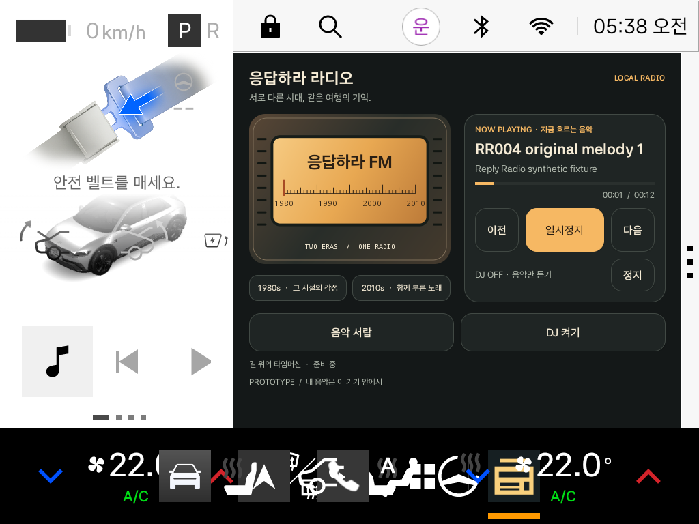
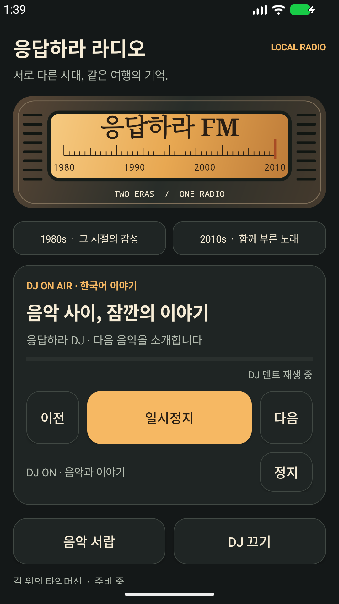

# UI-001 — 레트로 라디오 프로토타입

2026-11-15. 사용자의 요청에 따라 RR-007 구현을 중단하고 현재 음악·DJ 기능의 화면을 다듬었다. 대관령 예시 코스와 미승인 역사 자동 재생 차단 방침은 후속 RR-007에 유지한다. 이번에 위치 수집·역사 콘텐츠 승인·새 서버 연결을 추가하지 않았다.

## 화면

- **첫 화면:** 무음 개발 시뮬레이터 대신 실제 라디오 재생 화면을 연다. 화면 진입만으로 재생하지 않는다. 시뮬레이터 코드는 개발 검증용으로 남기고 외부 launcher에서 제외했다.
- **레트로 라디오:** 짙은 녹색·크림색·앰버 조명의 공통 디자인. 로컬 Canvas로 그린 시대 다이얼과 스피커 장식이며 실제 FM 주파수·오디오 레벨 측정값으로 표현하지 않는다. 표시 바늘은 현재 메타데이터의 시대와 연결한다.
- **현재 곡:** MediaBrowser의 실제 제목·아티스트·재생 시간·길이·DJ 상태를 표시한다. 대기·재생·일시정지·음성 실패를 구분한다. 가상의 곡명·날씨·이동 상태를 넣지 않았다.
- **큰 표준 제어:** 이전/재생 또는 일시정지/다음은 64dp, 정지는 48dp 이상. 중앙 버튼의 상태와 접근성 이름을 함께 갱신한다. MediaSession 명령과 기존 Reducer를 그대로 사용한다.
- **음악 서랍:** 파일 등록·권한 재확인·곡 카드·빈 목록 안내를 같은 스타일로 구성한다. 원본 파일 유지/실제 태그 상태 안내와 SAF 권한 처리는 유지한다. 라디오로 복귀하면 기존 라이브러리 조회 경로로 카탈로그를 다시 읽는다.
- **화면 크기:** 휴대폰 세로는 위아래, Pleos 가로는 좌우 구성이다. 긴 내용과 큰 글꼴을 위한 스크롤을 유지한다. 모든 화면 크기·글꼴 배율에서의 별도 검증은 하지 않았다.
- **차량 제한:** 상세 조작이 허용되지 않으면 음악 서랍·DJ 설정·준비 중 안내를 숨기고 표준 제어를 유지한다. 기존 UX gate와 서비스 측 권한 검사를 유지한다.

구현 파일: `ui/RadioTheme.kt`, `playback/PlaybackActivity.kt`, `catalog/CatalogActivity.kt`, manifest·문구 리소스. 새 네트워크/위치 권한, 원격 이미지, 폰트, 디자인 프레임워크 의존성은 추가하지 않았다. Android 실행 도메인·서버 모델·기존 테스트 소스는 변경하지 않았다.

## 검증

```powershell
backend/.venv/Scripts/python.exe -X utf8 tools/check_backend.py --evidence-prefix ui001
./tools/check.ps1 -Offline
python -X utf8 tools/check_rr005_device.py --serial emulator-5586 --avd ReplyRadio_RR003_API37 --picker --evidence-prefix ui001
python -X utf8 tools/check_rr005_device.py --serial emulator-5584 --avd ReplyRadio_RR003_API34 --evidence-prefix ui001
python -X utf8 tools/verify.py --report --require-devices --log evidence/build-20261115-134357-078.log
```

Pleos 검사는 [RR-005의 Virtual Console D/P 절차](rr005-voice-ux.md)를 사용한다. 장치는 작업용 AVD이며 사용자 음원 대신 합성 테스트 파일을 사용했다.

| 확인 | 결과 |
|---|---|
| 기존 JVM 테스트 | **177/177**, 소스 hash·실행 이름 유지 |
| 기존 서버 테스트 | **115/115**, 소스 hash·실행 이름 유지 |
| Android build/lint | debug/test APK 성공, lint 오류·경고 **0** |
| Pleos API34 | **38/38**, 새 APK로 음악·TTS·주행 제한/복원 재검증 |
| Android API37 | **38/38**, 새 APK로 SAF 선택·음악·한국어 TTS 재검증 |
| 원본 설계 | 27개 hash, 54+40개 인수 상태 유지 |

화면 캡처를 직접 확인하고 휴대폰에서 주요 버튼이 아래로 밀리는 레이아웃을 조정했다. 최종 화면은 실제 MP3 재생 중, 한국어 DJ 발화 중, 파일 선택 후, 차량 제한 중 상태에서 캡처했다. 음성의 실제 완료/정지·포커스·재생 연결도 기존 네이티브 검사로 확인했다. 물리 스피커 청취·실차 주행·디자인/안전 심사를 수행한 것은 아니다.

증거: [집계](../evidence/ui001.json), [서버](../evidence/ui001-backend.json), [Pleos](../evidence/ui001-device-ReplyRadio_RR003_API34.json), [Android](../evidence/ui001-device-ReplyRadio_RR003_API37.json). 기존 RR-005/006 보고서는 보존하고 UI-001 이름으로 새 증거를 남겼다.

## 현재 경계

시대는 기존 1980·2010년대 편성 그대로다. 시대 선택·역사 코너·다시듣기를 작동하는 것처럼 꾸미지 않았다. `길 위의 타임머신`은 준비 중으로 표시한다. Kotlin 서버 계약 검사와 로컬 Mock API는 유지하며 앱 HTTP 연결은 여전히 미연결이다. 다음 기능 작업을 재개할 때 RR-007의 실제 자료·지오메트리·권리·SDK 검증이 필요하다.

## 실제 화면




