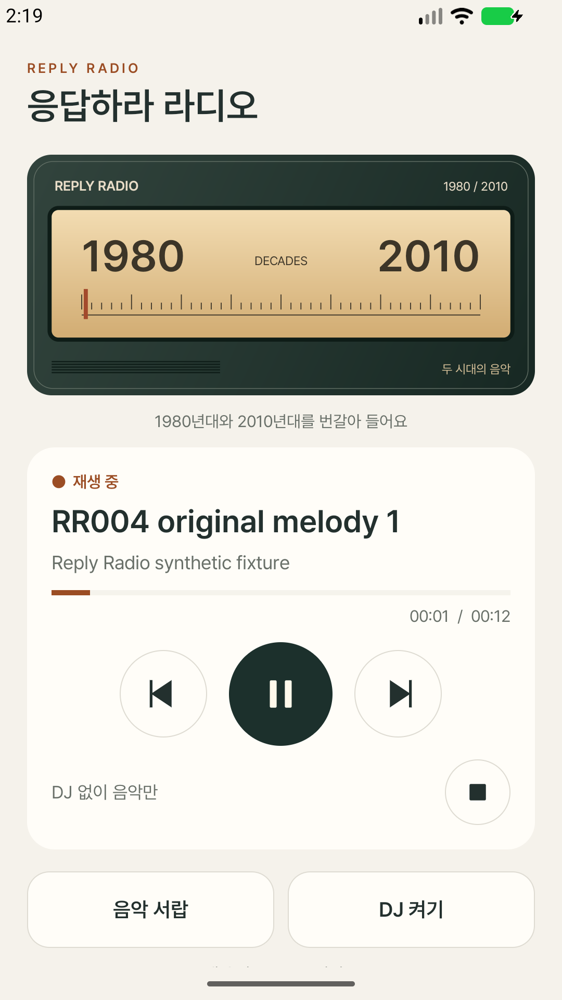
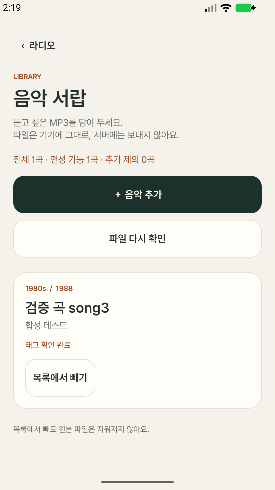
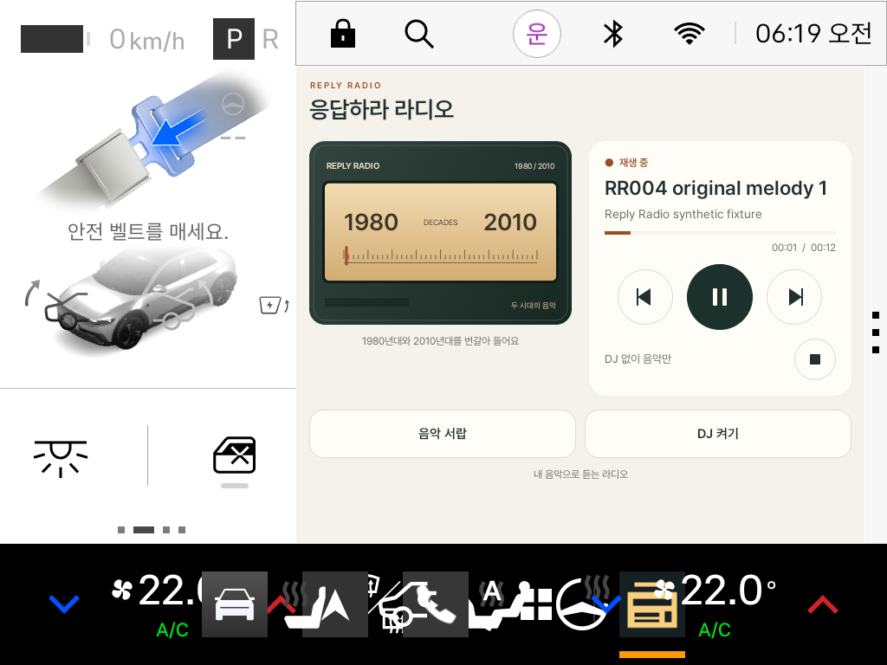

# UI-002 · 제품 화면과 문구 정리

2026-11-15. UI-001의 실제 재생 기능을 유지하면서 색상, 타이포그래피, 재생 제어와 음악 서랍을 다듬었다. RR-007은 중단 상태다. 대관령 예시·미승인 자동 재생 차단 방침은 유지한다.

## 화면

- 크림색 바탕, 짙은 녹색 라디오, 구리색 상태 표시로 색상을 줄였다. 카드 테두리와 중복 설명을 덜고 곡 제목에 시선이 모이도록 조정했다.
- Pretendard v1.3.9 Regular·SemiBold 원본을 번들링했다. TextView, Button, 라디오 Canvas가 같은 글꼴을 사용한다. 네트워크 요청은 없다.
- 재생·일시정지·이전·다음·정지는 직접 그린 표준 아이콘이다. 접근성 이름을 제공하며 터치 영역은 최소 48dp다. 재생 아이콘은 실제 MediaBrowser 상태를 따라 바뀐다.
- “첫 번째 추억”, “그 시절의 감성”, “READY WHEN YOU ARE” 같은 문구를 삭제했다. 빈 목록은 “아직 담은 음악이 없어요”, 로딩은 “음악을 불러오는 중”, 파일 등록은 “음악 추가”로 표시한다.
- 음악 서랍에서 제목·아티스트·연도·검사 결과를 구분했다. 삭제 안내는 원본을 지우지 않는다는 사실을 명시한다. `태그 확인 완료`는 디코더 재생 보증이 아니다.
- 휴대폰 세로·Pleos 가로에서 실제 화면을 확인했다. 사용 불가능한 역사 기능의 홍보 문구는 재생 화면에서 뺐다.

재생 전이, 음성 출력, SAF 수명, 차량 제한 로직은 수정하지 않았다. 추가 검사에서 Pleos 화면 종료 뒤 `Service not registered` 크래시를 관측했다. [Media3 1.6.1 원본](https://github.com/androidx/media/blob/1.6.1/libraries/session/src/main/java/androidx/media3/session/MediaControllerImplBase.java)의 지연 unbind와 Activity 연결 정리가 겹치는 것으로 판단해 브라우저 바인딩에 applicationContext를 사용했다. [수정 전 크래시](../evidence/ui002-lifecycle-before-fix.log)를 남겼다. 기존 onDestroy의 releaseFuture는 유지하고, 화면 3회 재진입 및 32초 지연 후 생존·자동 재생 금지를 검사한다. UI는 기존 MediaBrowser 명령과 상세 조작 gate를 사용한다. 중지 확인 실패를 “중지 완료”로 표시하지 않는다. 폰트는 [라이선스와 출처](../THIRD_PARTY_NOTICES.md), 원본 hash는 [기록](pretendard-provenance.json)을 참고한다.

## 재현

```powershell
backend/.venv/Scripts/python.exe -X utf8 tools/check_backend.py --evidence-prefix ui002
./tools/check.ps1 -Offline
python -X utf8 tools/check_ui002_device.py --serial emulator-5586
python -X utf8 tools/check_ui002_device.py --serial emulator-5584
python -X utf8 tools/check_rr005_device.py --serial emulator-5586 --avd ReplyRadio_RR003_API37 --picker --evidence-prefix ui002
python -X utf8 tools/check_rr005_device.py --serial emulator-5584 --avd ReplyRadio_RR003_API34 --evidence-prefix ui002
```

Pleos 제한 검사는 [Virtual Console D/P 절차](rr005-voice-ux.md)로 수행한다. 최종 `tools/verify.py --report --require-devices --log <이번 빌드 로그>`는 두 장치의 기본 38개와 UI 7개 검사에서 사용한 APK hash가 현재 빌드와 같은지 확인한다. 실제 디코더·TTS 실행에 사용하는 음원은 테스트 APK의 합성 음악이다.

기존 JVM 177개·서버 115개 소스와 실행 이름을 유지했다. 기존 장치 38개 검사의 본문은 유지하고 별도 `ui002` stage를 추가했다. 추가 검사는 빈 화면의 자동 재생 금지, 접근성 이름과 터치 영역, 버튼 직접 클릭에 따른 실제 음원 재생·일시정지·이전/다음·정지와 화면 재진입 7개다. 테스트 실행기에서 추가 stage로 분기하며 앱에는 테스트 코드를 포함하지 않는다.

증거: [집계](../evidence/ui002.json), [서버](../evidence/ui002-backend.json), [Pleos](../evidence/ui002-device-ReplyRadio_RR003_API34.json), [Android](../evidence/ui002-device-ReplyRadio_RR003_API37.json), [Pleos 버튼](../evidence/ui002-controls-ReplyRadio_RR003_API34.json), [Android 버튼](../evidence/ui002-controls-ReplyRadio_RR003_API37.json).

## 최종 결과

| 검사 | 결과 |
|---|---|
| 기존 JVM / 서버 | 177/177 · 115/115, 원본 테스트 유지 |
| Pleos API34 | 기존38/38 + UI7/7 |
| Android API37 | 기존38/38 + UI7/7 |
| debug APK / test APK / lint | 성공 · 오류0 · 경고0 |
| 원본 설계 / 글꼴 | 27개 hash·54+40 인수 상태 보존, OFL 원본 hash·APK 포함 확인 |

최종 빌드 로그: [build-20261115-141638-649.log](../evidence/build-20261115-141638-649.log). `--require-devices`로 양쪽 장치의 기본 검사·UI 검사와 최종 APK의 hash 일치를 확인했다. 개발 중 첫 실행기의 등록·테스트 데이터 주입 오류를 수정했고, 화면 수명 크래시는 별도로 재현·수정했다. 최종 결과는 수정 후 새 실행만을 집계한다.

## 실제 화면

 



## 남은 범위

이 작업은 UI 품질 개선이다. 판매용 release 빌드·서명·기기별 UX 심사·실차 주행·물리 스피커 청취까지 완료한 것은 아니다. 음악 서랍은 기존 debug 접근 경계를 유지하며, 외부 모델·앱 HTTP·실제 위치·역사 콘텐츠도 활성화하지 않았다. 에뮬레이터의 기본 글꼴 배율에서 확인했으며 모든 해상도·접근성 배율·TalkBack 탐색 순서를 검증한 것은 아니다.
